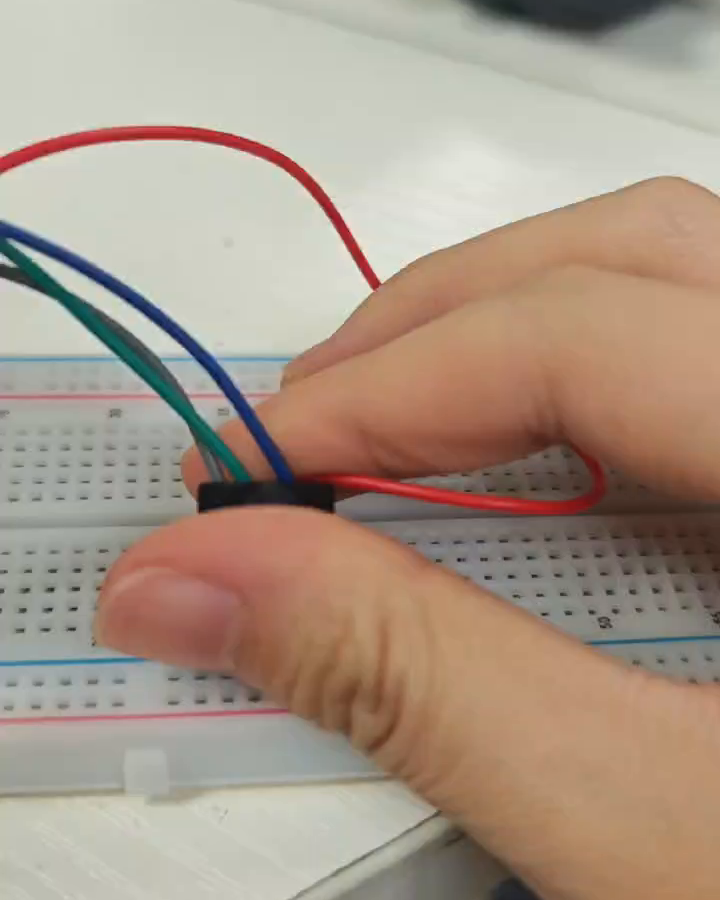
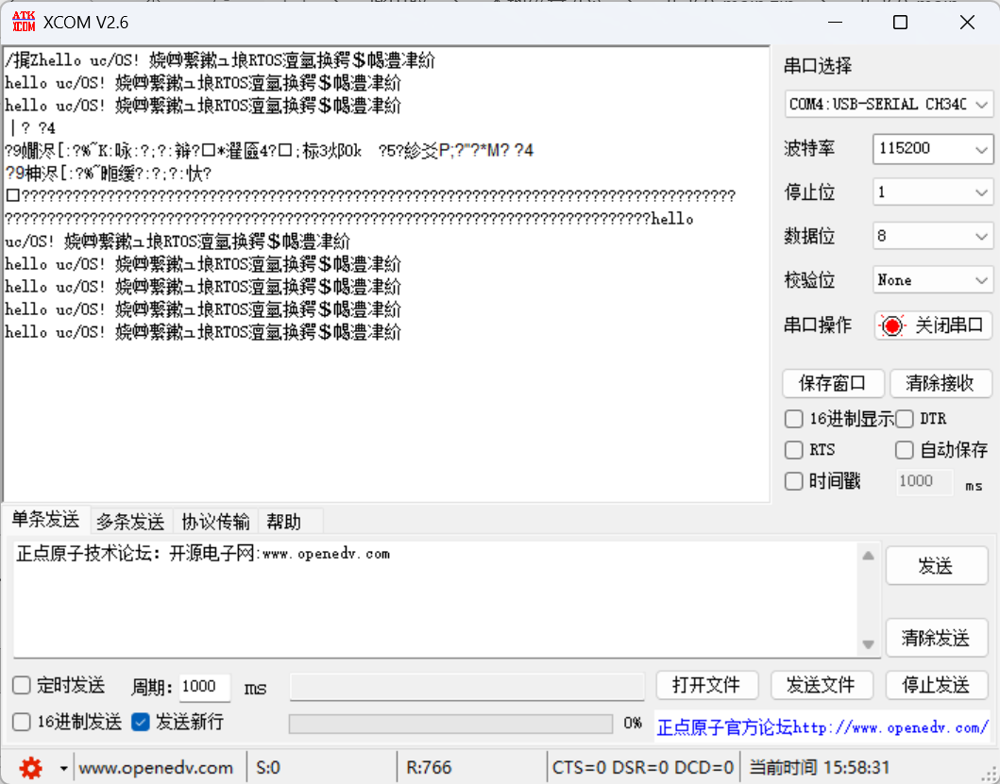
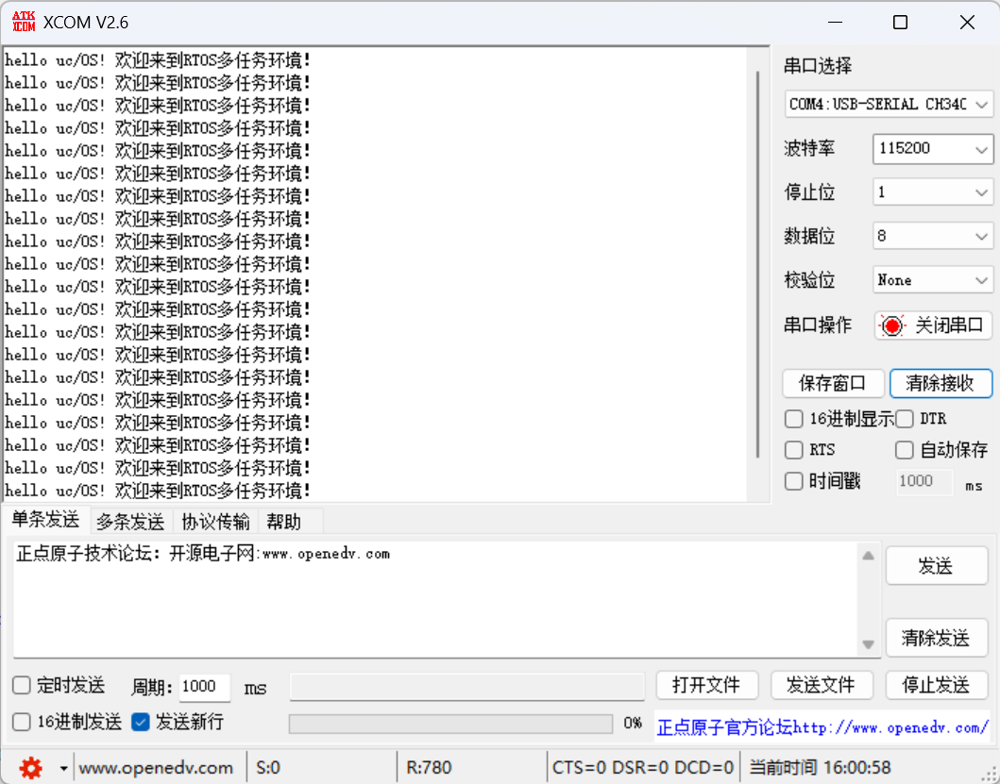
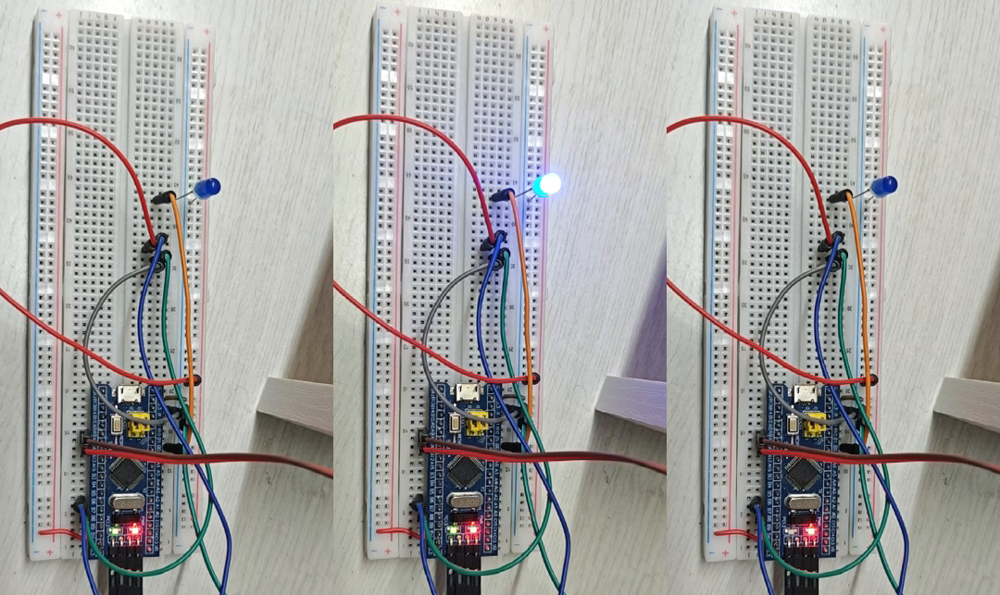
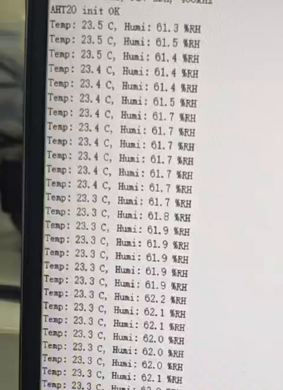
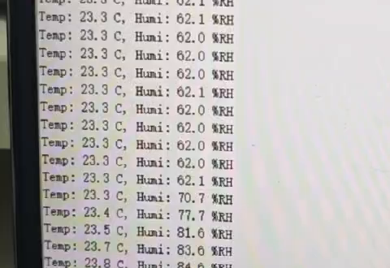

# STM32F103C8T6 移植 uC/OS-III 3.08 + AHT20 温湿度采集（HAL + Keil AC6 全流程）

> 实验环境：STM32F103C8T6 最小系统板 + AHT20 + ST-Link V2 + USB-TTL
> 软件：Keil MDK 5.37 / ARM Compiler 6（V6.18）/ STM32F1 HAL / uC/OS-III V3.08.02
> 代码：https://github.com/____________
> 文中图片位于 `docs/figures/`，发布到 CSDN 时用编辑器的图片按钮逐张上传即可。

## 一、前言：为什么要上 RTOS

裸机程序通常是“一个 `while(1)` + 中断”，所有功能串行执行。一旦某个环节需要等待（比如 AHT20 测量要等 80 ms），CPU 就只能空转，其他功能全被拖住。

RTOS 把功能拆成多个独立任务，由内核按优先级调度，用系统节拍（Tick）驱动延时和超时。延时期间 CPU 去跑别的任务，这就是“并发”的来源。

本次实验的目标：

1. 把 uC/OS-III 移植到 STM32F103C8T6；
2. 建三个任务：LED1 每 1 s、LED2 每 3 s、串口每 2 s 打印 `hello uc/OS!`；
3. 把第 3 个任务改成每 2 s 采集一次 AHT20 温湿度并通过串口输出；
4. 用示波器/逻辑分析仪观察 I2C 时序，对照 AHT20 手册分析地址和命令。

## 二、实验环境与接线

| 项目 | 说明 |
|---|---|
| 主控 | STM32F103C8T6，64 KB Flash / 20 KB SRAM |
| 晶振 | 外部 8 MHz，PLL ×9 → 72 MHz |
| 传感器 | AHT20，I2C 接口，7 位地址 0x38 |
| 调试 | ST-Link V2，SWD |
| 串口 | USART1，PA9/PA10，115200-8-N-1 |
| 工具 | Keil MDK 5.37 + AC6，串口助手 XCOM |

接线：

| STM32 | AHT20 | | STM32 | USB-TTL |
|---|---|---|---|---|
| 3.3V | VCC | | PA9 (TX) | RXD |
| GND | GND | | PA10 (RX) | TXD |
| PB6 | SCL | | GND | GND |
| PB7 | SDA | | | |

LED1 用板载 PC13，LED2 用外接 PB0（串联 1 kΩ 限流电阻到 GND）。



## 三、uC/OS-III 移植原理（Cortex-M3）

Cortex-M3 有两个栈指针：MSP（主栈，异常/中断使用）和 PSP（进程栈，任务使用）。移植层要做四件事：

1. **任务栈初始化** `OSTaskStkInit()`
   按异常入栈帧格式（R0-R3、R12、LR、PC、xPSR）伪造一个“刚被中断打断”的现场，任务第一次被调度时就能靠异常返回进入函数。

2. **上下文切换** `OSCtxSw()` / `OS_CPU_PendSVHandler()`
   触发 PendSV，在 PendSV 里把 R4-R11 压入当前任务栈，切换 `OSTCBCurPtr`，再从新任务栈恢复 R4-R11 和 PSP。

3. **系统节拍** `OS_CPU_SysTickHandler()`
   `OSIntEnter()` → `OSTimeTick()` → `OSIntExit()`，为延时、超时、时间片提供 1 ms 时基。

4. **临界区** `CPU_SR_Save()/Restore()`
   用 `PRIMASK`/`BASEPRI` 关中断，配合 `CPU_CFG_KA_IPL_BOUNDARY` 区分“内核感知”和“非内核感知”中断。

关键点：**PendSV 必须设为最低优先级（0xFF）**，否则上下文切换可能打断其他中断；SysTick 设为内核边界优先级（本实验为 4）。

## 四、源码准备

uC/OS-III 从 V3.08 起是 Apache-2.0，可以直接从 GitHub 拉：

```bash
git clone --depth 1 https://github.com/weston-embedded/uC-OS3.git
git clone --depth 1 https://github.com/weston-embedded/uC-CPU.git
git clone --depth 1 https://github.com/weston-embedded/uC-LIB.git
```

需要复制到工程里的文件：

```
Middlewares/
├─ uC-OS3/
│  ├─ Source/            16 个 .c（os_core.c、os_task.c、os_tick.c …）
│  ├─ Ports/             os_cpu.h、os_cpu_c.c、os_cpu_a.asm
│  └─ Cfg/               os_cfg.h、os_cfg_app.h、os_app_hooks.c/h
├─ uC-CPU/
│  ├─ cpu_core.c、cpu_core.h、cpu_def.h、cpu_cfg.h
│  └─ Port/              cpu_c.c、cpu.h、cpu_a.asm
└─ uC-LIB/
   ├─ lib_ascii.c、lib_math.c、lib_mem.c、lib_str.c、lib_def.h、lib_cfg.h
```

## 五、Keil 工程搭建

在一个能编译的 HAL 工程（C8 + startup_stm32f103xb.s + CMSIS）基础上，分 8 个组：

`Application`、`HAL`、`CMSIS`、`uC-OS3`、`uC-OS3 Port`、`uC-OS3 Cfg`、`uC-CPU`、`uC-LIB`。

Include Paths 一定要包含：

```
.\Middlewares\uC-OS3\Source
.\Middlewares\uC-OS3\Ports
.\Middlewares\uC-OS3\Cfg
.\Middlewares\uC-CPU
.\Middlewares\uC-CPU\Port
.\Middlewares\uC-LIB
```

宏定义：`STM32F103xB, USE_HAL_DRIVER`。

## 六、配置修改（重点，也是坑最多的地方）

### 1. cpu_cfg.h

```c
#define  CPU_CFG_ENDIAN_TYPE            CPU_ENDIAN_TYPE_LITTLE
#define  CPU_CFG_NVIC_PRIO_BITS         4u
#define  CPU_CFG_KA_IPL_BOUNDARY        4u
```

模板里 `CPU_CFG_NVIC_PRIO_BITS` 默认在 `#if 0` 里，不打开会直接 `#error`。

### 2. os_cfg_app.h

```c
#define  OS_CFG_TICK_RATE_HZ    1000u   /* 1 ms 节拍 */
```

### 3. 关掉 FPU

F103 是 Cortex-M3，没有 FPU，但 ARMv7-M 的移植层默认按“有 FPU”写：

- `os_cpu.h`：`#define OS_CPU_ARM_FP_EN 0u`
- `os_cpu_a.asm`：删掉两段 `IF {FPU} != "SoftVFP"` 里的 `VSTMDBEQ / VLDMIAEQ`

不删的话 armasm 直接报 `Unknown opcode 'VSTMDBEQ'`。

### 4. AC6 兼容

AC6 没有 `__isb/__dsb` 内建函数，在 `cpu_cfg.h` 里补：

```c
#if defined(__ARMCC_VERSION) && (__ARMCC_VERSION >= 6010050)
#define __isb(x)  __builtin_arm_isb(x)
#define __dsb(x)  __builtin_arm_dsb(x)
#endif
```

另外 `os_cpu_c.c` 里的 `#include "../../../Source/os.h"` 要改成 `#include "os.h"`（工程已把 Source 加进头文件路径）。

## 七、中断对接与启动流程

启动文件里的 `SysTick_Handler`、`PendSV_Handler` 都是 `[WEAK]` 死循环，必须在 C 里重定义：

```c
void SysTick_Handler(void)
{
    HAL_IncTick();              /* 保留 HAL 的 1 ms 计数 */
    OS_CPU_SysTickHandler();    /* uC/OS-III 系统节拍 */
}

void PendSV_Handler(void)
{
    OS_CPU_PendSVHandler();     /* 上下文切换 */
}
```

启动顺序：

```c
HAL_Init();
SystemClock_Config();     /* HSE 8 MHz ×9 = 72 MHz，失败退 HSI */
MX_USART1_UART_Init();
MX_I2C1_Init();
BSP_Init();

CPU_Init();
OSInit(&err);
AppTaskCreate();
OS_CPU_SysTickInit(SystemCoreClock / OS_CFG_TICK_RATE_HZ);
OSStart(&err);            /* 永不返回 */
```

## 八、三个任务

| 任务 | 优先级 | 栈 | 周期 | 功能 |
|---|---|---|---|---|
| Task1_LED1 | 5 | 512 字 | 1 s | 翻转 PC13 |
| Task2_LED2 | 6 | 512 字 | 3 s | 翻转 PB0 |
| Task3 | 7 | 512 字 | 2 s | 串口 hello / AHT20 采集 |

```c
static void AppTaskLed1(void *p_arg)
{
    OS_ERR err;
    while (1) {
        BSP_LED_Toggle(0u);
        OSTimeDlyHMSM(0u, 0u, 1u, 0u, OS_OPT_TIME_HMSM_STRICT, &err);
    }
}

static void AppTaskHello(void *p_arg)
{
    OS_ERR err;
    while (1) {
        printf("hello uc/OS! " HELLO_CN "\r\n");
        OSTimeDlyHMSM(0u, 0u, 2u, 0u, OS_OPT_TIME_HMSM_STRICT, &err);
    }
}
```

任务创建（V3.04 以后 `OSTaskCreate` 有 13 个参数）：

```c
OSTaskCreate(&Task1TCB, "Task1_LED1", AppTaskLed1, (void *)0, 5u,
             &Task1Stk[0], TASK_STK_SIZE/10u, TASK_STK_SIZE,
             (OS_MSG_QTY)0, (OS_TICK)0, (void *)0,
             OS_OPT_TASK_STK_CHK | OS_OPT_TASK_STK_CLR, &err);
```

串口中文用 GBK 字节输出，避免 XCOM 乱码：

```c
#define HELLO_CN  "\xBB\xB6\xD3\xAD\xC0\xB4\xB5\xBD" "RTOS" \
                  "\xB6\xE0\xC8\xCE\xCE\xF1\xBB\xB7\xBE\xB3\xA3\xA1"
```

改之前 XCOM 里是这样的（UTF-8 被当成 GBK）：



改之后：



## 九、AHT20 驱动

手册要点：

- 7 位地址 **0x38**，HAL 里写 `0x38 << 1 = 0x70`（读 0x71）；
- 上电后等 ≥40 ms；
- 初始化命令 `0xBE 0x08 0x00`；
- 触发测量 `0xAC 0x33 0x00`，等 80 ms；
- 读 6 字节：状态 + 5 字节数据（湿度 20 位 + 温度 20 位）；
- 换算：

```
RH  = raw_h / 2^20 × 100 %
T   = raw_t / 2^20 × 200 − 50 ℃
```

在 RTOS 里，把驱动内部的 `HAL_Delay(80)` 换成 `OSTimeDly`，等待期间让出 CPU：

```c
void AHT20_DelayMs(uint32_t ms)
{
    OS_ERR err;
    if (OSRunning == OS_STATE_OS_RUNNING) {
        OSTimeDlyHMSM(0u, 0u, 0u, ms, OS_OPT_TIME_HMSM_STRICT, &err);
    } else {
        HAL_Delay(ms);
    }
}
```

## 十、示波器看 I2C 时序

CH1 接 PB6（SCL），CH2 接 PB7（SDA），共地，SCL 下降沿触发，开 I2C 解码，能看到：

```
START → 0x70 W → ACK → 0xBE → ACK → 0x08 → ACK → 0x00 → ACK → STOP
```

地址字节 `0x70` 就是 `0x38 << 1`，最低位 0 表示写；随后两条命令分别对应“校准”和“触发测量”。

400 kHz 快速模式的关键参数：

| 参数 | 要求 |
|---|---|
| fSCL | ≤ 400 kHz |
| tLOW | ≥ 1.3 μs |
| tHIGH | ≥ 0.6 μs |
| tSU;STA / tHD;STA | ≥ 0.6 μs |
| tSU;DAT | ≥ 0.1 μs |
| tSU;STO | ≥ 0.6 μs |
| tBUF | ≥ 1.3 μs |

理论 SCL 周期 2.5 μs，地址 + ACK 共 9 个时钟约 22.5 μs。

## 十一、实验结果

任务一：串口每 2 s 一行（见上文），PC13 1 s、PB0 3 s 翻转。



AHT20：初始化成功，温湿度每 2 s 输出；哈气后湿度从 62% 升到 84%。





## 十二、踩坑清单

| 现象 | 原因 | 解决 |
|---|---|---|
| `CPU_CFG_NVIC_PRIO_BITS not #define'd` | 宏在 `#if 0` 里 | 打开并设为 4u |
| `Unknown opcode VSTMDBEQ` | 移植层按有 FPU 写 | 删 FPU 汇编块，`OS_CPU_ARM_FP_EN=0` |
| `Undefined symbol __isb` | AC6 无该内建 | `__builtin_arm_isb/dsb` |
| 串口半行卡死 | 没重定义 SysTick_Handler | C 里重定义 SysTick/PendSV |
| 中文乱码 | 固件 UTF-8 vs XCOM GBK | 固件直接输出 GBK 字节 |
| `HAL_I2C_Master_Transmit` 返回 HAL_BUSY | 没上拉/地址错/F1 errata | 加上拉、降速、重新 Init |

## 十三、总结

这次从零把 uC/OS-III 3.08 搬到 F103C8，踩的坑主要集中在三处：**配置模板的默认值**（NVIC 优先级位数、FPU）、**AC6 与 AC5 的差异**（`__isb`、汇编语法）、**中断对接**（SysTick/PendSV 必须自己接管）。理清 Cortex-M3 的 MSP/PSP 和 PendSV 机制后，移植本身并不复杂。

AHT20 部分则验证了 I2C 的地址、命令和时序，也体会到“阻塞延时”和“任务让出”在 RTOS 下的区别。

代码与报告：https://github.com/____________

## 参考资料

1. uC/OS-III 源码（Apache-2.0）：https://github.com/weston-embedded/uC-OS3
2. STM32F103C8T6 移植 uC/OS-III 基于 HAL 库完整过程（CSDN）
3. uC/OS-III 移植踩坑总结（CSDN）
4. 野火《STM32 库开发实战指南》第 23 章 I2C 读写 EEPROM
5. AHT20 产品手册（奥松电子）
